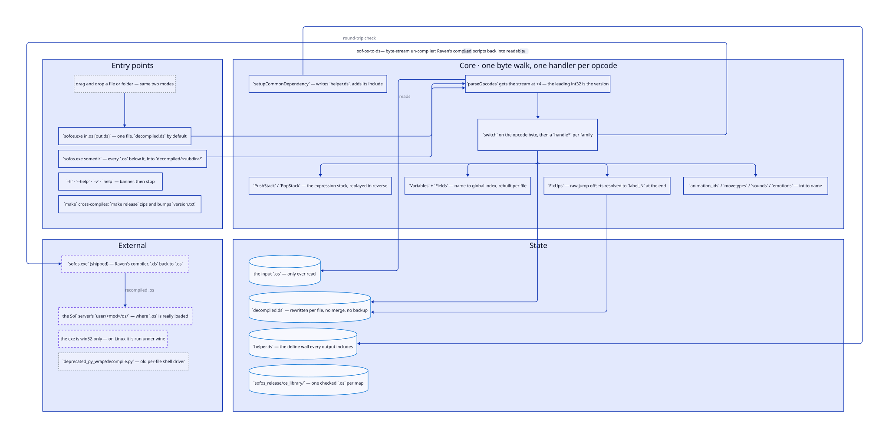

# sof-os-to-ds — for humans

> A Windows command-line tool that turns a compiled Soldier of Fortune `.os` designer script back into readable `.ds` source.

Read it left to right:

- **Entry points** — `sofos.exe in.os [out.ds]`, or a directory (or a drag-and-drop) to convert every `.os` below it into `decompiled/<subdir>/`. There is no config file and no batch mode beyond that; `-h` / `--help` prints the banner.
- **Core** — this is not a decompiler in the usual sense, it is a byte-stream un-assembler. The `.os` file stores no line structure at all, so the leading int32 (format version) is skipped and the rest is a straight `switch` on opcode bytes. That is why the output has more labels and `goto`s than the original script: `if` / `while` / `else` are reconstructed as `CODE_IF` + `CODE_GOTO` offsets and only get names (`label_N`) in a fix-up pass at the end.
- **State** — three files matter. `decompiled.ds` is rewritten per run with no merge and no backup, so point the second argument somewhere sane. `helper.ds` is emitted from a 32 KB string literal compiled into the exe and holds the `#define` wall (sound channels, animation names, movetypes, emotions); it is rewritten automatically whenever its checksum is not `0x89`, so hand edits do not survive.
- **Verification** — the repo ships Raven's own `sofds.exe`; the only real test is recompiling the `.ds` back into a `.os` and loading it on a server from `user/<mod>/ds/`. `sofos_release/os_library/` keeps one known `.os` per map as the corpus to run that loop over.
- **Sharp edges** — directory mode recurses, but when it rebuilds an input path it keeps the root plus the *deepest* directory name only, so files more than one level down are looked for at a path that does not exist. The build is win32-only (`shlwapi`, console API, `_findfirst`), so on Linux it runs under wine, and `deprecated_py_wrap/decompile.py` is the old per-file shell wrapper that directory mode replaced.

Source: [`docs/system.d2`](docs/system.d2). Edit that, then run [`scripts/render-diagram.sh`](scripts/render-diagram.sh).
